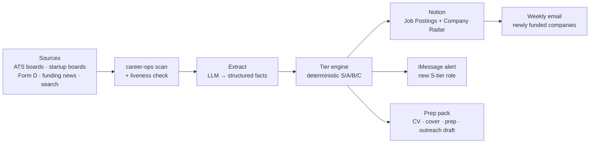

# career-ops-deployment-kit

**A deployment layer for [career-ops](https://github.com/santifer/career-ops): the open-source AI job search agent, configured and extended for one demanding user.**

> Status: shipped 2026-11-20, and running every day since 2026-11-03 (7 AM and 1 PM). All nine phases are done; the Form D upstream contribution is open with career-ops. See the [roadmap](docs/ROADMAP.md).


## Why this exists

I'm searching for customer- and strategy-facing AI deployment roles (Deployment Strategist, Forward Deployed PM, AI Strategist, BizOps/S&O, Chief of Staff) at AI-native and frontier tech companies in New York. That search has two problems:

- **Recall.** There's no standard title. The right role might be called "Deployment Strategist," "AI Transformation," or "Forward Deployed PM," and many live only on a company's own job board or at a company that raised money last week.
- **Precision.** Titles mislead. A "Forward Deployed" role can be a software engineering job; a "Deployment" PM can be internal inference infrastructure; a BizOps role can be back-office or quota-carrying.

Rather than build a job search tool from scratch, I built on career-ops, which already handles ATS scanning, liveness checks, evaluation, and tracking well. This repo is everything I added on top: my judgment encoded as testable rules, sources it doesn't have, and delivery that fits how I actually work.

It's also the deployment job in miniature: take a general platform, configure it for one customer's workflow, extend it where it falls short, measure whether it works, and iterate.

## What this kit adds to career-ops

| Area | career-ops provides | This kit adds |
|---|---|---|
| Scoring | A–H evaluation, 1–5 score | Structured extraction + a **deterministic tier engine** (S/A/B/C) with caps, red-flag penalties, and a "why this tier" explanation |
| Precision | Archetype detection | Trap detection: engineer-in-disguise roles, internal-infra "deployment" roles, quota-carrying sales |
| Sources | Public ATS APIs, funding RSS | **SEC Form D** funding filings, search-based discovery, NYC tech funding sites |
| Companies | Static portal list | **Company Radar**: auto-enriched list of AI companies with an NYC presence |
| Delivery | Markdown tracker, Notion mirror | Notion databases mapped to my workflow, **instant iMessage alerts** for top roles, weekly funded-companies email |
| Prep | CV tailoring, cover letters, interview prep | Paced, automatic prep packs for top-tier roles, every CV line fact-checked |
| Quality | Upstream test suite | An **eval set** of real roles with my expected tiers, run on every rule change |

## Results so far

From the first daily run on 2026-11-03 to 2026-11-20:

| | |
|---|---|
| Job postings tracked | **55,082** from **496** company job boards plus investor portfolio boards (7,912 in New York) |
| Roles graded by the tier engine | **580**: 63 S · 107 A · 76 B · 242 C · 92 excluded or below the walk-away pay |
| Funding signals | **3,015** SEC Form D filings screened and **236** funding rounds recorded; **686** companies tracked |
| Prep packs | **24** built for top roles. **4** held for a human look by the meaning check: 1 real stretch, 3 true lines the check couldn't yet see (fixed in D121) |

**Accuracy** (2026-11-20, rules as of today): **21 of 24** real postings get the tier I'd give them (88%); on the **12 roles the rules never saw** while being written, **10 of 12** (83%). Of the 3 misses, 2 are the AI misreading a role's shape and 1 is a rule; the report says which, so each miss points at its fix. The labeled roles themselves stay private.

## How it works



**Design principle: the model extracts, code decides.** The LLM reads each job description and returns structured facts (role shape, pay range, years asked, red flags with quotes). A small, unit-tested rules engine turns those facts into a tier. When a role is mis-tiered, the eval set shows whether extraction or a rule was wrong.

More detail: [docs/ARCHITECTURE.md](docs/ARCHITECTURE.md) · design decisions: [docs/DECISIONS.md](docs/DECISIONS.md)

## Principles

- **Built on career-ops, not a fork.** career-ops stays unmodified, so upstream updates keep flowing. Everything here plugs into its documented extension points.
- **Human in the loop.** Nothing is ever submitted or sent on my behalf. Outreach is drafts only. No LinkedIn scraping or automated sign-in.
- **Private by construction.** Personal data and keys live outside this repo entirely (see [docs/SECURITY.md](docs/SECURITY.md)).
- **Honest outputs.** Tailored CV lines are checked against the source CV; no invented facts or numbers.

## Repo layout

```
install.sh   one-command setup (career-ops at the pinned commit + private folder from templates)
rules/       target-role definition and house rules (templates; real values stay private)
extractor/   AI extraction (no tools), job-board readers, SEC Form D, funding news, company research
engine/      deterministic tier engine + tests
market/      the market database: every posting seen, scans, Company Radar
packs/       prep packs: tailored CV, cover letter, interview prep, outreach draft, fact checks
notion/      Notion sync (Job Postings + Company Radar)
delivery/    weekly email through Apple Mail
scripts/     daily runner, setup check, launchd install
evals/       eval runner (labeled roles live in the private folder)
examples/    made-up facts files for trying the tier engine
docs/        architecture, decisions (D1–D128), roadmap, security
```

## Possible next steps

- Company Radar for San Francisco Series A–C AI companies (D73).
- Switches to run without Notion or Serper (D128 keeps them required for now).

## Setup

Needs macOS (the daily run uses Messages, Mail, Reminders and launchd), Node 22.13+, git, the [Claude Code](https://claude.com/claude-code) CLI, a [Notion](https://www.notion.so/my-integrations) integration and a [Serper](https://serper.dev) key.

```bash
mkdir job-search && cd job-search
git clone https://github.com/gmmarken/career-ops-deployment-kit.git
career-ops-deployment-kit/install.sh
```

`install.sh` downloads career-ops at the pinned commit next to the kit, creates a `private/` folder beside it from the templates (it never overwrites a file there), installs the secret-scan hook, and runs the setup check. Then open Claude Code in the kit folder and run `/onboard`: it interviews you and fills in `private/` (CV, target roles, tier rules, sources, daily run) until `node scripts/check-setup.mjs` passes. Last, `scripts/install-daily.sh --load` schedules the 7 AM and 1 PM runs.

## Credits

- [career-ops](https://github.com/santifer/career-ops) by santifer (MIT): the platform this kit is built on.
- [Everything Claude Code](https://github.com/affaan-m/ECC) (MIT): selected skills used during development (credited where used).
- Built with [Claude Code](https://claude.com/claude-code).

## License

MIT, see [LICENSE](LICENSE).
