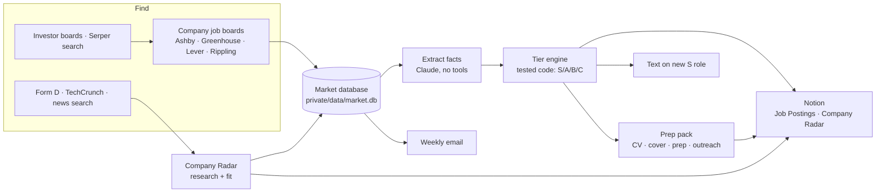

# Architecture (as built, 2026-11-20)

The kit runs on one Mac, twice a day, and does four jobs: **find** job postings and newly funded companies, **grade** the promising roles, **prepare** application material for the best ones, and **tell** the candidate. Everything personal stays in a private folder beside the repo; the decisions behind each part are in [DECISIONS.md](DECISIONS.md) (D-numbers below).

## 1. Three folders side by side

| Folder | What | In git |
|---|---|---|
| `career-ops/` | [career-ops](https://github.com/santifer/career-ops) (MIT), downloaded by `install.sh` at the pinned commit `a068b71`. Never edited (D1, D128). | upstream only |
| `career-ops-deployment-kit/` | This repo: all the code, prompts, rules templates, tests and docs. | yes |
| `private/` | The candidate's CV, target-role profile, tier settings, keys (`.env`), the market database, prep packs, logs and backups. | never |

Every script finds `private/` beside the kit; career-ops scripts are run through `scripts/co.sh`, which points career-ops' data folder (`CAREER_OPS_DATA_DIR`) at `private/` so nothing personal is written inside `career-ops/`.

## 2. What comes from career-ops, and what the kit adds

The kit is built on career-ops but uses a focused part of it. It takes:
- **The profile and rules file formats** (`modes/_profile.md`, `modes/_custom.md`, `config/profile.yml`): the candidate's target roles and house rules are written in career-ops' formats, and the kit reads sections of them.
- **CV rendering:** `build-cv-html.mjs` and `generate-pdf.mjs` turn a tailored CV into a one-page PDF.
- **The fact gate:** `verify-cv-facts.mjs` checks every number and claim in a document against the CV and the approved facts (`config/cv-facts.json`).
- **ATS checks:** `keyword-match.mjs` and `verify-ats.mjs` measure keyword coverage and how well applicant-tracking software can read the CV.

The kit's own code does everything else: reading job boards and funding sources, the market database, AI extraction, the tier engine, company research, Notion, prep-pack writing and checking, texts, the weekly email and the scheduler. career-ops' own scanner, evaluation reports, tracker and plugins are not used.

## 3. The daily run

The Mac's scheduler (launchd) starts a small helper app (`CareerOps Daily.app`, D65) at 7 AM and 1 PM, which runs `scripts/daily.sh` → `scripts/daily.mjs`. Each step runs on its own; a step that fails is reported and the others still run.

| # | Step | What happens | AI? |
|---|---|---|---|
| 1 | **Scan** (`market.sh scan`) | Reads every known company job board (Ashby, Greenhouse, Lever, Rippling) in full, plus investor portfolio boards (Getro, a16z-style) to find new company boards. Once a week, a Serper search finds more boards. Every posting goes into the market database; a role missing from 2 good scans in a row is closed. Borderline NYC titles get a no-AI text check. | no |
| 2 | **Grade** (`tier-new.sh`) | Up to the daily limit (30 by default) of new NYC roles in target families (`config/daily.json`). For each: code reads the hard facts from the board (title, pay, location, dates); Claude, with no tools, reads the description and returns judgment facts, each with a quote; for a role that could reach S or A, a separate Claude call researches the company on the web. The **tier engine** (plain tested code) decides S / A / B / C. Each new S role gets its own text right away. | yes |
| 3 | **Company Radar** (`market.sh radar`, morning only) | SEC Form D filings, TechCrunch funding feeds and a daily Serper news search find newly funded NYC companies. Up to 10 a day are researched (what they do, leaders, NYC presence, careers page) and scored for deployment fit by code. A news story that doesn't say where a company is gets a short AI check for NYC. | research, NYC check |
| 4 | **Prep packs** (`packs.sh build`) | For S roles, at most about 1 a day (3 a day, 5 a week): see section 5. | yes |
| 5 | **Weekly email** (Sundays) | Newly funded NYC companies and new roles, sent through Apple Mail. | no |
| 6 | **Backup** (morning only) | A dated copy of the market database, kept in the iCloud-synced workspace. | no |

The midday run does steps 1, 2 and 4 for roles first seen that day. At the end of each run, one summary text goes out through Messages (and a Reminders pop-up for problems). A problem that keeps coming back is ⚠️ from its 2nd day and 🚨 from its 5th; a broken run sends 🚨 at once (D115).

**The Mac has to be awake.** A daily power schedule wakes the Mac at 6:55 and `caffeinate` keeps it awake while the run lasts, but nothing keeps a laptop with its lid closed awake. Then the run only moves during the short wakes macOS does by itself and takes hours. Leave the lid open overnight, plugged in (the screen still turns off). Step time limits count only time the Mac was awake; a step that runs out of time while the Mac slept is a temporary problem with a 💤 line in the summary, and a real one if it happens 5 mornings in a row (D130).

## 4. The main design rule: the model extracts, code decides

Claude never decides a tier. It reads a posting and fills in a fixed form (`extractor/judgment.schema.json`): role family, strategic or tactical, traps such as an engineering job with a strategy title, red flags such as quota ownership, years asked, work model, each with a quote from the posting. Code checks the answer against the form, then `engine/tier-engine.mjs` applies the candidate's rules (`config/tier-rules.json`) in a fixed order: exclusions, requirements (language, clearance, full-time), walk-away pay, location, traps, five criteria, seniority, caps, drops (see [engine/README.md](../engine/README.md)). Every role keeps a step-by-step "why this tier". `node scripts/tier-facts.mjs examples/…` shows it with made-up roles.

Because the rules are code, they have tests (one or more per rule), and the accuracy check (`scripts/evals.sh`) can say whether a wrong tier came from the AI's reading or from a rule: 21 of 24 labeled roles match, 10 of 12 on roles the rules never saw (2026-11-20).

## 5. Prep packs: the AI writes, code checks every line

`packs/build.mjs`, for one S role:
1. Code reads `cv.md` into numbered lines, plus the posting and the company research.
2. Claude (no tools) tailors the CV: it may only reword lines that exist, and must say which line each bullet came from. Code checks that, plus the locked lines, the line rules and that every number appears in the CV (D84, D98).
3. career-ops' fact gate checks the whole CV; career-ops renders the PDF.
4. Claude (no tools) drafts the cover letter, interview prep and outreach. Code and the fact gate check them.
5. A second Claude read (the meaning check, D106) compares each sentence the candidate would send with its source line: a new claim holds the pack back; a stronger claim is flagged.
6. The pack lands in `private/output/packs/` and on the role's Notion page. Nothing is ever sent or submitted.

## 6. Where data lives

- **Market database** (`private/data/market.db`, SQLite): every posting seen with open and close dates, every scan, tier history, companies, funding rounds, prep-pack queue. History is kept, not overwritten (D38–D40), and monthly numbers freeze 7 days after the month ends. See [market/README.md](../market/README.md).
- **Notion** is the working view: the candidate triages roles and makes company calls (Status, Verified, Watch, AI-native) there; the kit reads those calls back and never overwrites them (D26). See [notion/README.md](../notion/README.md).

## 7. Safety

- **Keys** live only in `private/.env`. A gitleaks check blocks any commit that looks like a secret, locally and on GitHub. Before going public, every commit on every branch and every PR and issue was scanned (D125).
- **Job postings are untrusted text.** Every Claude call that reads one runs with no tools, in an empty folder, never with `--dangerously-skip-permissions`; only the kit's code writes files or calls services. Company research is a separate call that gets only the company name.
- **Nothing is sent for the candidate.** The only messages are texts and the weekly email to the candidate. No LinkedIn scraping or sign-in.
- **Fail loudly.** A missing key, file or source is an error with its fix, never a quiet default. `scripts/check-setup.mjs` lists every setup problem at once.

## 8. Code map

| Folder | What |
|---|---|
| `extractor/` | Job-board readers, AI extraction and its prompt and schemas, company research, Form D, funding news, Serper |
| `engine/` | Tier engine and its rules loader, deployment-fit scoring for the Radar |
| `market/` | Market database, scans, title classifier, Company Radar, metrics |
| `packs/` | Prep-pack building, checks, prompts, rendering, queue |
| `notion/` | Notion client, database layouts, sync |
| `delivery/` | Weekly email and Apple Mail sending |
| `scripts/` | Daily run, the `*.sh` entry points, setup check, launchd install |
| `evals/` | Accuracy check runner (labeled roles stay private) |
| `rules/`, `examples/`, `*.example.*` | Templates and made-up examples |
